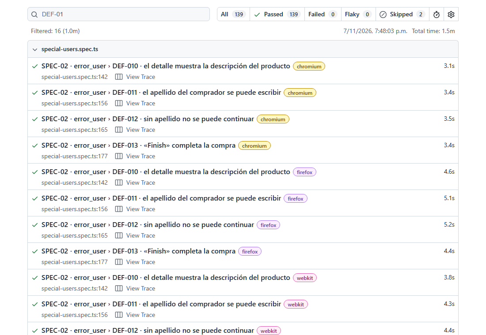
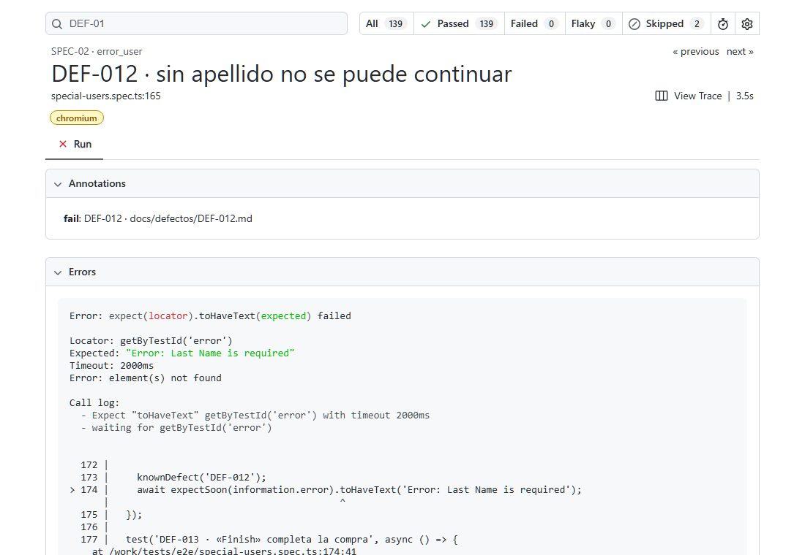

# QA E2E con Playwright — Sauce Demo

[](https://github.com/rolandocesar-prog-dev/qa-e2e-playwright/actions/workflows/ci.yml)

Suite de pruebas end-to-end sobre [Sauce Demo](https://www.saucedemo.com), un sitio público creado
para practicar automatización. Parte de un **plan de pruebas** con casos priorizados y trazables, y
se ejecuta en cuatro navegadores en cada cambio y una vez al día.

**[Ver el último reporte de pruebas →](https://rolandocesar-prog-dev.github.io/qa-e2e-playwright/)**

## Resultados

| Métrica                                     | Valor                                                              |
| ------------------------------------------- | ------------------------------------------------------------------ |
| Casos del plan automatizados                | 21 de 21 ([`requirements.md`](./specs/requirements.md))            |
| Pruebas por ejecución                       | 139 (35 por navegador × Chromium, Firefox, WebKit y Chrome móvil)  |
| Defectos encontrados y documentados         | **13** ([`docs/defectos/`](./docs/defectos/README.md)), 2 críticos |
| Pruebas inestables en 30 ejecuciones del CI | **0 de 4 170** (la primera medición encontró una y se corrigió)    |
| Accesibilidad (WCAG 2.1 A/AA, axe)          | 0 violaciones en el inicio de sesión y el catálogo                 |
| Login de `performance_glitch_user`          | ≈ 5,1 s (límite 10 s)                                              |



## Qué demuestra

- **Plan de pruebas primero** (Spec Driven Development): cada caso tiene ID y prioridad, y cada
  prueba empieza con su ID para trazarla al plan.
- **Page Object Model**, fixtures (sesión iniciada con `storageState`) y selectores estables
  (`data-test`), sin esperas fijas.
- **Defectos reales documentados**: con los usuarios especiales del sitio se encontraron 13
  defectos (imágenes, orden, carrito, detalle, datos del comprador, validación y compra). Cada uno
  tiene su reporte y una prueba marcada con `test.fail()` justo antes de la aserción que falla:
  pasa mientras el defecto exista y avisa cuando se corrige.
- **Pruebas que se prueban**: control con un usuario sano para cada defecto, inyección de
  violaciones para comprobar que axe las detecta y un resultado alterado para validar el cálculo
  de inestabilidad.
- **Calidad no funcional**: accesibilidad con axe, rendimiento percibido y regresión visual.
- **Mismo entorno en local y en el CI**: la imagen oficial de Playwright en Docker, para que las
  capturas coincidan píxel a píxel.
- **CI** con lint, tipos, las cuatro suites de navegadores, reporte publicado en GitHub Pages,
  ejecución diaria y un workflow que mide la estabilidad en 30 ejecuciones.



## Lo que se aprendió

- **El sitio es una SPA**: la URL cambia antes que el contenido. Leer un elemento justo después de
  navegar puede leer la página anterior; las pruebas esperan algo que solo existe en la página
  nueva.
- **Un formulario puede borrar lo escrito** si se llena en cuanto aparece (pasó bajo carga en
  WebKit). Se llena y se confirma el valor, reintentando sin esperas fijas.
- **Una falla esperada no deja evidencia** con la configuración habitual («solo si falla»): las
  pruebas de defectos guardan captura y _trace_ siempre.
- **Medir la estabilidad sirve**: la primera medición encontró que la regresión visual fallaba 3
  de 30 veces por **un píxel**. Con una tolerancia acotada, la segunda dio 0 fallas.

## Stack

Playwright · TypeScript · axe-core · ESLint (eslint-plugin-playwright) · Prettier · Docker ·
GitHub Actions · GitHub Pages

## Cómo ejecutarlo

```bash
npm ci
npx playwright install
npm test            # todas las pruebas, en paralelo
npm run test:ui     # modo interactivo
npm run report      # abre el último reporte HTML
```

Para el mismo entorno que el CI (imagen oficial de Playwright, necesaria para la regresión visual
y para correr Firefox donde no arranca de forma nativa), con Docker:

```bash
npm run test:docker                                  # toda la suite en el contenedor
npm run test:docker -- --update-snapshots -g VIS-01  # regenerar las capturas de referencia
```

## Cómo se desarrolla

El proyecto sigue **Spec Driven Development** aplicado a QA:

- [`specs/requirements.md`](./specs/requirements.md): plan de pruebas y casos.
- [`specs/design.md`](./specs/design.md): estructura, patrones y decisiones de la suite.
- [`specs/tasks.md`](./specs/tasks.md): plan por hitos.
- [`docs/defectos/`](./docs/defectos/README.md): defectos encontrados, con plantilla.

## Licencia

[MIT](./LICENSE). Sauce Demo es propiedad de Sauce Labs; este proyecto solo lo usa como sitio de
práctica.
